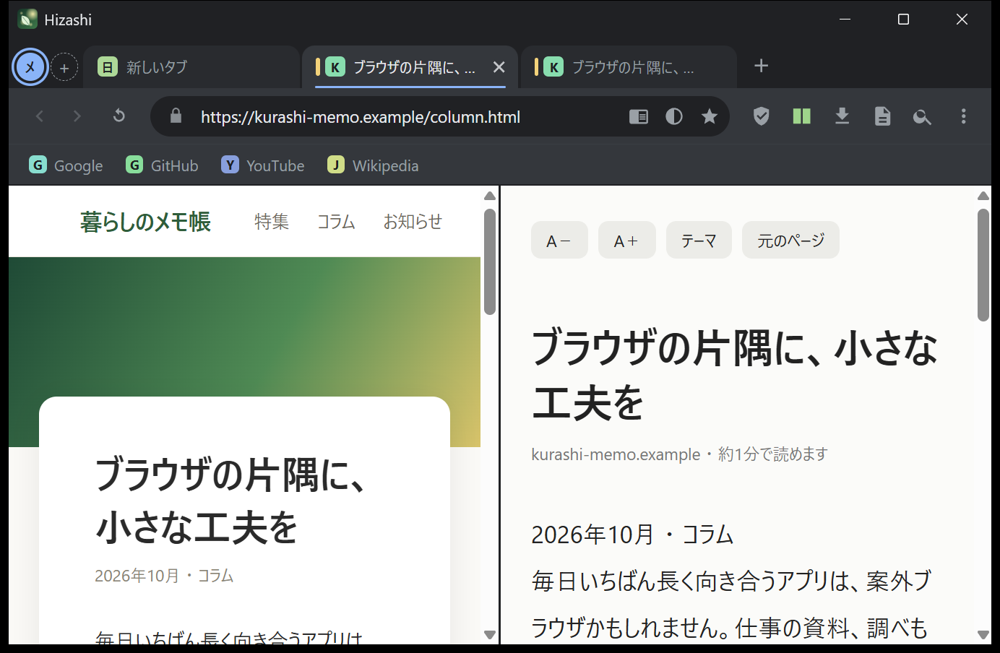
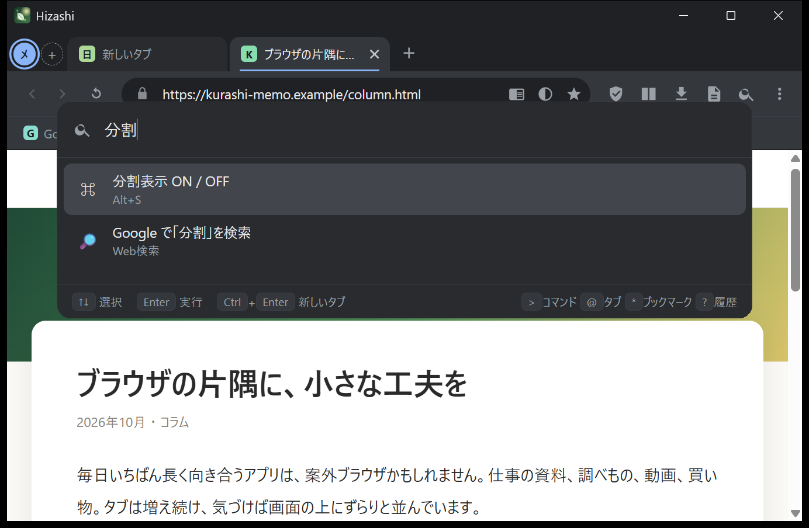
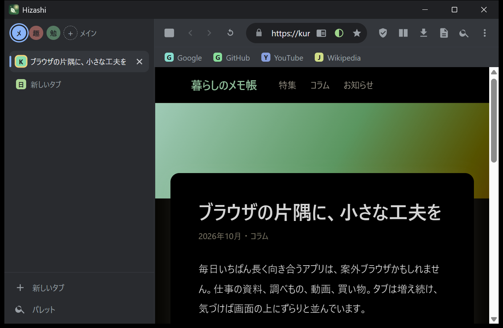

<p align="center">
  
</p>

<h1 align="center">Hizashi (日差し)</h1>

<p align="center">
  A feature-rich desktop browser for Windows, powered by Chromium (Edge WebView2).<br>
  <b>One exe — just double-click.</b>
</p>

<p align="center">
  <a href="https://github.com/kaikomziu/hizashi/releases/latest"></a>
  <a href="LICENSE"></a>
  
</p>

<p align="center"><a href="README.md">日本語</a></p>



> The UI is currently **Japanese only**. Translations are welcome.

## Download

1. Get `Hizashi.exe` from [**Releases**](https://github.com/kaikomziu/hizashi/releases/latest).
2. Double-click it. No installer, and no separate .NET install needed.

> If Windows SmartScreen says *"Windows protected your PC"*: the exe is not code-signed (it's a hobby project). Click **More info → Run anyway**. The full source is here, you can build it yourself, and the release lists a SHA-256 checksum.

Requires Windows 10/11 and the **WebView2 Runtime** (preinstalled on Windows 11).

Press `Ctrl+K` after launch — most things are reachable from the command palette.

## Features

- **Command palette** (`Ctrl+K`) — fuzzy-search tabs, bookmarks, history and every command; also a calculator.
- **Workspaces** — color-coded tab groups (`Alt+1…9`).
- **Vertical tabs** (`Ctrl+Shift+L`) with a collapsible sidebar; drag to reorder.
- **Split view** (`Alt+S`) — two tabs side by side.
- **Focus mode** (`Ctrl+Shift+F`) — block distracting sites (editable list) for a set time.
- **Reader mode** (`F9`) — article extraction, font size, light/sepia/dark themes, reading time.
- **Element blocker** (`Ctrl+Shift+X`) — click to hide page elements; remembered per site.
- **Ad / tracker blocking** (domain-based), **HTTPS auto-upgrade**, **tracking-parameter stripping** (`utm_*`, `fbclid`, …).
- **Per-site dark mode and zoom**, **auto-sleeping tabs**, session restore.
- **Screenshots** — visible area or the **full page**; saved and copied to the clipboard.
- **Quick notes**, address-bar search shortcuts (`yt cats`, `gh electron`, `map Tokyo`), PiP, mobile view, download manager, and more.

<p align="center">
  
  
</p>

## Privacy

- Hizashi sends **no telemetry** and has no accounts.
- History, bookmarks, notes and settings are stored locally in `%APPDATA%\Hizashi`; cookies and cache in `%LOCALAPPDATA%\Hizashi\WebView2`.
- The rendering engine (WebView2 Runtime) is Microsoft's and follows your Windows diagnostic-data setting.
- Ad blocking is domain-based; first-party ads (e.g. YouTube video ads) are not blocked.

## Limitations

- **No browser extensions.**
- Google sign-in may be flagged as an "insecure browser" (the browser identifies itself as Chrome, but this is still being verified).
- No private windows or account sync yet. Windows only.

## Build

Requires the .NET 9 SDK.

```bat
git clone https://github.com/kaikomziu/hizashi.git
cd hizashi
run.bat          :: build and run
publish.bat      :: dist\Hizashi.exe (self-contained single file)
```

## How it works

A C# / WinForms shell around Edge WebView2. Inside the window, WebView2 controls are stacked: **chrome UI → one per tab → overlay (palette, panels)**. The UI is plain HTML/CSS/JS embedded in the exe and served from a virtual host. There is an end-to-end self-test: `Hizashi.exe --selftest main` (see the Japanese README).

## License

[MIT](LICENSE)
